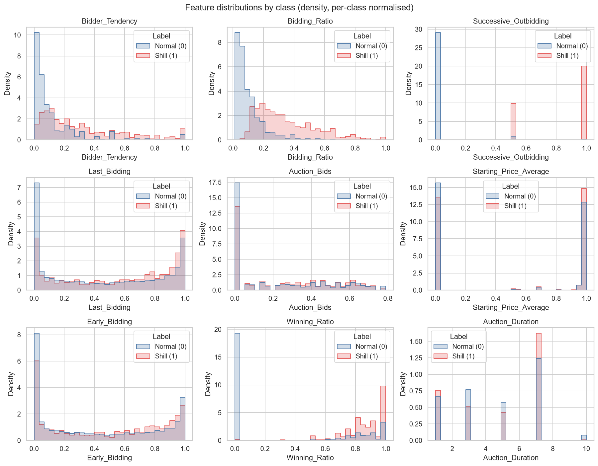
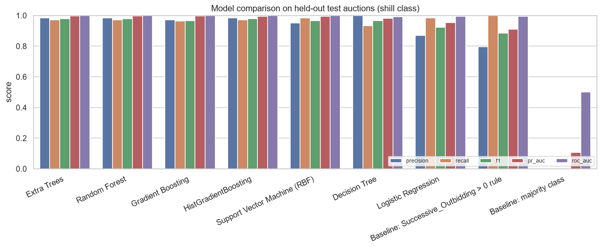
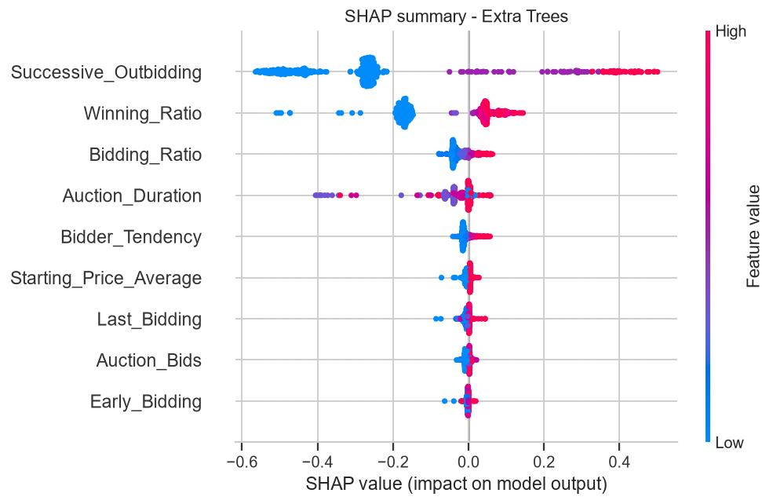

# Machine Learning-Based Detection and Analysis of Shill Bidding Activities in Online Auctions

A complete, reproducible Python project that analyses the **UCI Shill Bidding Dataset (ID 562)**,
compares eight classifiers and two baselines under leakage-aware validation, explains individual
predictions, and keeps a persistent **suspicious-activity backlog** for human investigation — all
presented through a Streamlit dashboard.

> A positive prediction marks a **potential shill-bidding case that requires investigation**.
> It is a statistical signal learned from labelled historical data, not proof of fraud or intent.

---

## Contents

1. [Introduction](#1-introduction) · 2. [Problem statement](#2-problem-statement) ·
3. [Background](#3-background-what-is-shill-bidding) · 4. [Objectives](#4-motivation-and-objectives) ·
5. [Dataset](#5-dataset) · 6. [Source & licence](#6-official-source-citation-and-licence) ·
7. [Features](#7-feature-explanations) · 8. [EDA](#8-exploratory-data-analysis) ·
9. [Preprocessing](#9-preprocessing-methodology) · 10. [Algorithms](#10-algorithms-evaluated) ·
11. [Model selection](#11-model-selection) · 12. [Metrics](#12-performance-metrics) ·
13. [Results](#13-results-and-discussion) · 14. [Backlog](#14-fraud-backlog-management) ·
15. [Limitations](#15-limitations) · 16. [Installation](#16-installation) · 17. [Execution](#17-execution) ·
[Project structure](#project-structure) · [Testing](#testing)

---

## 1. Introduction

Online auctions rely on honest competition between bidders. Shill bidding undermines that
competition by injecting fake demand. This project builds a machine-learning system that
recognises bidding behaviour resembling labelled shill-bidding cases, explains why a record was
flagged, and supports the follow-up investigation workflow.

## 2. Problem statement

Given behavioural indicators describing one bidder's activity in one auction, classify the record
as **normal** (`Class = 0`) or **potential shill bidding** (`Class = 1`), estimate a fraud
probability, explain the prediction, and record flagged cases for investigation — while measuring
performance honestly on auctions the model has never seen.

## 3. Background: what is shill bidding?

Shill bidding is a fraudulent practice in which a seller, or someone colluding with the seller,
places artificial bids on the seller's own auction to raise the final price:

1. A seller lists a product.
2. A genuine buyer places a bid.
3. A shill bidder outbids them, often with small increments, without any intention to buy.
4. The genuine buyer raises their bid and pays an artificially inflated price.

It is classed as fraud because the bids deliberately misrepresent demand, deceive other
participants and transfer money from buyers to the seller through manipulation. Auction platforms
prohibit it.

## 4. Motivation and objectives

* Understand which behaviours distinguish shill from normal bidding in real auction data.
* Compare linear and non-linear classifiers under a consistent, leakage-aware methodology.
* Select a model on evidence (cross-validation), not on the test set.
* Explain predictions in behavioural terms.
* Provide a persistent backlog that separates **model predictions** from **investigation outcomes**.

## 5. Dataset

| Property | Value (measured) |
|---|---|
| Records | 6,321 (one bidder in one auction) |
| Columns | 13 = 3 identifiers + 9 behavioural features + `Class` |
| Missing values / duplicate rows | 0 / 0 |
| Normal (0) / Shill (1) | 5,646 (89.32%) / 675 (10.68%) — imbalance 8.36 : 1 |
| Auctions / masked bidder IDs | 807 / 1,054 |

The data were scraped by the dataset creators from eBay auctions of a popular product and
preprocessed into normalised behavioural indicators.

**Retrieval.** The recommended `ucimlrepo.fetch_ucirepo(id=562)` call was attempted first, but the
UCI API reports this dataset as *"not available for import"* (its metadata has `target_col: null`).
The loader therefore falls back to UCI's **official ZIP download**
(`archive.ics.uci.edu/static/public/562/...`). No Kaggle copies or third-party mirrors are used.
Retrieval details are saved to `data/raw/uci_metadata.json`.

## 6. Official source, citation and licence

* Dataset page: <https://archive.ics.uci.edu/dataset/562/shill+bidding+dataset>
* DOI: <https://doi.org/10.24432/C5Z611>
* Licence: **Creative Commons Attribution 4.0 International (CC BY 4.0)**

Citation, exactly as registered for the DOI (DataCite lists the author as "Unknown"):

```
Shill Bidding Dataset (2020). UCI Machine Learning Repository. https://doi.org/10.24432/C5Z611
```

```bibtex
@misc{shill_bidding_dataset_562,
  title     = {Shill Bidding Dataset},
  year      = {2020},
  publisher = {UCI Machine Learning Repository},
  doi       = {10.24432/C5Z611},
  url       = {https://archive.ics.uci.edu/dataset/562}
}
```

The source code is MIT-licensed (see `LICENSE`); the dataset remains under CC BY 4.0.

## 7. Feature explanations

Descriptions follow UCI's official variable information.

| Column | Role | Meaning (UCI) | Measured at |
|---|---|---|---|
| `Record_ID` | identifier | Unique record ID | – |
| `Auction_ID` | identifier / grouping | Unique auction ID | – |
| `Bidder_ID` | identifier / grouping | Masked bidder ID (e.g. `_***i`) | – |
| `Bidder_Tendency` | predictor | Shill bidders participate exclusively in auctions of few sellers (collusion) | bidder |
| `Bidding_Ratio` | predictor | Shill bidders bid more frequently to raise the price | bidder in auction |
| `Successive_Outbidding` | predictor | Shill bidders outbid themselves while already winning, with small increments | bidder in auction |
| `Last_Bidding` | predictor | Shill bidders become inactive in the last stage (>90% of duration) to avoid winning | bidder in auction |
| `Auction_Bids` | predictor | Auctions with shill bidding have more bids than concurrent auctions | auction |
| `Starting_Price_Average` | predictor | Shill sellers tend to offer a small starting price | auction |
| `Early_Bidding` | predictor | Shill bidders bid early (<25% of duration) to attract attention | bidder in auction |
| `Winning_Ratio` | predictor | Shill bidders compete in many auctions but hardly win | bidder |
| `Auction_Duration` | predictor | How long the auction lasted (days) | auction |
| `Class` | target | 0 = normal, 1 = shill bidding | – |

**Observation on encoding.** Shill records have *higher* `Winning_Ratio`, `Last_Bidding` and
`Starting_Price_Average` than normal records, the opposite of what the raw quantities in the UCI
descriptions would suggest. The indicators therefore appear to be encoded as *suspicion scores*
(higher = more shill-like). UCI does not publish the formulas, so this is an observation from the
data, not a documented fact.

## 8. Exploratory data analysis

Full, auto-generated report: [`reports/dataset_analysis_report.md`](reports/dataset_analysis_report.md);
interactive version in the dashboard's **Dataset Explorer**. Key measured findings:

* **`Successive_Outbidding` is almost deterministic.** It takes only the values 0, 0.5 and 1. Of the
  5,478 records with value 0, only 2 are shill; rank-biserial effect size 0.98.
* Other strong separators: `Bidding_Ratio` (effect 0.84), `Winning_Ratio` (0.65), `Bidder_Tendency` (0.57).
  `Auction_Bids`, `Starting_Price_Average`, `Auction_Duration` differ only weakly (effect < 0.1).
* **Redundancy:** `Last_Bidding`–`Early_Bidding` Spearman 0.95 (identical in 61.4% of records — single-bid
  bidders) and `Bidding_Ratio`–`Winning_Ratio` 0.80.
* **Group structure:** auction-level features are constant within every auction, and 472 of the 478 auctions
  containing shill records also contain normal records. A random row split would put records of the same
  auction in both train and test.
* **Masked bidder IDs are not unique keys:** among masked IDs with several records, `Bidder_Tendency` and
  `Winning_Ratio` (which should be per-bidder) are constant in only 13% and 19% of cases.



## 9. Preprocessing methodology

* **Cleaning** (`src/preprocessing/cleaner.py`): schema validation, dtype enforcement, duplicate removal.
  These steps learn nothing from the data, so they are safe before splitting.
* **Identifiers are never predictors.** `BehaviouralFeatureSelector` (`src/preprocessing/transformer.py`)
  raises an error if an identifier or the target is requested as a feature; a test also checks that
  shuffling identifiers does not change any prediction. Identifiers are kept for grouping, tracking and
  the backlog.
* **Pipelines:** selection → median imputation (defensive; the official data has no gaps) → standard
  scaling (Logistic Regression and SVM only) → model. Everything is fitted on training folds only.
* **Class imbalance:** handled with `class_weight` as a tuned hyper-parameter rather than resampling, so no
  synthetic records are created and nothing can leak across folds.
* **Feature selection** (training split only): dropping the less informative member of each correlated
  pair (`Early_Bidding`, `Winning_Ratio`) lowered mean CV PR-AUC by 0.008, above the 0.005 tolerance, so
  **all nine features are kept**.
* **Leakage / temporal availability:** `Last_Bidding`, `Auction_Bids`, `Winning_Ratio` and final
  `Bidding_Ratio` are only known after an auction ends. The system is therefore a **retrospective,
  post-auction investigation tool**, not real-time fraud prevention.

## 10. Algorithms evaluated

| Model | Why it is a candidate |
|---|---|
| Majority-class dummy | Lower bound; shows why accuracy is misleading |
| Rule: `Successive_Outbidding > 0` | Domain baseline built from the strongest EDA signal |
| Logistic Regression | Interpretable linear baseline (scaled inputs) |
| Decision Tree | Human-readable rules, non-linear thresholds |
| SVM (RBF kernel) | Non-linear margin classifier; needs scaling; calibrated with `CalibratedClassifierCV` |
| Random Forest | Variance-reduced tree ensemble; feature importances |
| Extra Trees | Randomised tree ensemble; often strong on small tabular data |
| Gradient Boosting | Boosted shallow trees for complex interactions |
| HistGradientBoosting | Fast boosting with native class weighting |

XGBoost/LightGBM were not added: scikit-learn's boosting implementations cover the same model family
without extra dependencies.

## 11. Model selection

* **Hold-out test set:** one fold of a shuffled `StratifiedGroupKFold` **grouped by `Auction_ID`**
  (seed 42): 1,268 records / 161 auctions, shill share 10.73% (train 10.67%). **Zero** shared auctions or
  records between train and test.
* **Why auction-grouped?** The intended use is scoring records of *new, completed auctions*. Grouping by
  auction prevents the auction-level context of test records from being seen during training.
  Row-based CV is reported for comparison; bidder-grouped CV is reported as approximate because masked
  IDs are not unique.
* **Tuning:** `GridSearchCV` with 5-fold auction-grouped CV on the training split, scoring
  **average precision (PR-AUC)**.
* **Selection rule (CV only):** highest mean CV PR-AUC; models within 0.005 of the best are tied and the
  simplest tied model wins (then lower fold variance).
* **Threshold:** chosen on **out-of-fold training predictions** by maximising F2 (recall weighted ×2)
  subject to precision ≥ 0.80. The test set is never used for selection or thresholding.

**Selected model: Extra Trees** (`max_features=0.5`, `class_weight='balanced_subsample'`, unlimited depth,
300 trees) — highest CV PR-AUC (0.9985 ± 0.0020). Random Forest, Gradient Boosting and
HistGradientBoosting fell within the tolerance; Extra Trees and Random Forest share the lowest complexity
rank in that group and Extra Trees had the lower fold variance. Optimised threshold: **0.50**.

## 12. Performance metrics

Accuracy alone is misleading here: predicting "normal" for everything already scores 89.3%. The project
reports precision, recall, F1, ROC-AUC, PR-AUC (average precision), Brier score and confusion matrices
for the **shill class**.

* **False positive** – a normal bidder is flagged: costs investigator time and could wrongly cast suspicion
  on a legitimate user. The precision floor keeps the review queue manageable.
* **False negative** – a shill bidder is missed: the manipulation goes unreviewed and buyers keep
  overpaying. Recall is therefore weighted more heavily (F2) when choosing the threshold.

## 13. Results and discussion

All numbers are measured by `run_pipeline.py` (seed 42). Complete tables:
[`reports/model_comparison_report.md`](reports/model_comparison_report.md),
[`reports/model_comparison.csv`](reports/model_comparison.csv).

**Held-out test auctions (each model at its own CV-optimised threshold):**

| Model | CV PR-AUC | Thr. | Precision | Recall | F1 | ROC-AUC | PR-AUC | FP | FN |
|---|---|---|---|---|---|---|---|---|---|
| **Extra Trees (selected)** | 0.9985 | 0.50 | 0.9851 | 0.9706 | 0.9778 | 0.9996 | 0.9973 | 2 | 4 |
| Random Forest | 0.9977 | 0.44 | 0.9851 | 0.9706 | 0.9778 | 0.9996 | 0.9973 | 2 | 4 |
| Gradient Boosting | 0.9975 | 0.23 | 0.9704 | 0.9632 | 0.9668 | 0.9994 | 0.9959 | 4 | 5 |
| HistGradientBoosting | 0.9953 | 0.72 | 0.9851 | 0.9706 | 0.9778 | 0.9993 | 0.9956 | 2 | 4 |
| SVM (RBF) | 0.9890 | 0.33 | 0.9504 | 0.9853 | 0.9675 | 0.9994 | 0.9951 | 7 | 2 |
| Decision Tree | 0.9870 | 0.77 | 1.0000 | 0.9338 | 0.9658 | 0.9920 | 0.9804 | 0 | 9 |
| Logistic Regression | 0.9583 | 0.09 | 0.8701 | 0.9853 | 0.9241 | 0.9936 | 0.9528 | 20 | 2 |
| Rule `Successive_Outbidding > 0` | 0.9033 | 0.50 | 0.7953 | 1.0000 | 0.8860 | 0.9934 | 0.9104 | 35 | 0 |
| Majority class | 0.1067 | 0.50 | 0.0000 | 0.0000 | 0.0000 | 0.5000 | 0.1073 | 0 | 136 |

Selected model confusion matrix on the test set: **TP 132, FP 2, FN 4, TN 1,130** (accuracy 0.9953).

**Discussion**

* **What ML adds over the rule.** The single rule already catches every test shill record but produces 35
  false alarms (precision 0.80). The selected model cuts false alarms to 2 (precision 0.985) at the cost
  of 4 missed cases — a far more workable investigation queue.
* **Dependence on one behaviour.** Removing `Successive_Outbidding` drops CV PR-AUC to 0.75–0.76 for all
  three model families tested (from 0.956 for Logistic Regression and 0.995–0.998 for the tree ensembles). Permutation importance (0.76 of 0.997 average precision) and
  mean |SHAP| (0.33, next `Winning_Ratio` 0.12) confirm it dominates.
* **Validation strategy.** For this dataset, row-based, auction-grouped and bidder-grouped CV give similar
  PR-AUCs (e.g. Random Forest 0.9975 / 0.9976 / 0.9973), so row-level leakage inflates estimates only
  slightly here — but auction-grouped evaluation is the methodologically correct choice and is used
  throughout.
* **Unseen bidders.** 1,187 of the 1,268 test records carry a masked bidder ID also present in training.
  On those, recall is 125/125; on the 81 records with unseen IDs it is **7/11**, and **all four missed
  shill records are in that group**. The sample is small, but it suggests performance on genuinely new
  bidders may be lower than the headline figures — an important caveat for deployment.
* **Label provenance.** Scores near 1.0 are unusual for fraud detection. UCI's page does not describe how
  the labels were produced; if they were derived from these same indicators, the model is partly learning
  to reproduce that labelling procedure.




### Interpretability

* **Global:** permutation importance on the test auctions, impurity importance, mean |SHAP| and a SHAP
  summary plot; readable rules from the tuned Decision Tree.
* **Local:** each prediction shows the probability, predicted class, SHAP contributions per feature
  (`TreeExplainer`; linear SHAP for Logistic Regression; occlusion fallback for other models), the
  record's values next to typical normal/shill values, and a plain-language explanation. Attributions
  describe how the model uses each behaviour — **not causation or intent**.

## 14. Fraud backlog management

Implemented in `src/backlog/` with SQLite (`data/backlog/fraud_backlog.db`), persisting across restarts.

| Table | Content |
|---|---|
| `backlog` | Backlog ID, Record/Auction/Bidder ID, fraud probability, predicted class & label, threshold, prediction timestamp, model version, **review status**, investigation notes, top contributing features, feature values, source |
| `status_history` | Audit trail of every status change and note (who, when, old → new) |
| `prediction_log` | Every scored record (flagged or not) for "records analysed" statistics |

Review statuses: *Pending Review → Under Investigation → Confirmed Suspicious / False Positive → Closed*.
Only flagged records enter the backlog, always as *Pending Review*; the model's prediction is never
overwritten — the review status records the investigator's conclusion separately.

Dashboard functions: view all cases, search by bidder/auction/record ID, filter by probability range and
status, open case details, update status, add notes, export filtered or full backlog to CSV, and view
historical statistics (status mix, flags over time, most-flagged bidder IDs, confirmation rate).

## 15. Limitations

* **Retrospective features** — several indicators need the auction to have ended; no real-time claim is made.
* **Label provenance unknown** — near-perfect scores may partly reflect how labels were created.
* **Single dominant indicator** — performance collapses without `Successive_Outbidding`.
* **Masked, non-unique bidder IDs** — limit bidder-level analysis and bidder-grouped validation; weaker
  recall on unseen bidder IDs (small sample).
* **Narrow data** — one product category on one platform at one time; behaviour elsewhere may differ.
* **Retraining** — the deployed model is the one trained on the training split and evaluated on the test
  split; it is not silently refitted on all data, so the reported test metrics describe exactly the
  deployed artefact.
* **Predictions are not proof** — every flag requires human review.

## 16. Installation

Requires **Python 3.11+** (developed and tested with Python 3.13 on Windows 11).

```bash
python -m venv .venv
```

Windows:

```bash
.venv\Scripts\activate
```

macOS / Linux:

```bash
source .venv/bin/activate
```

```bash
pip install -r requirements.txt
```

## 17. Execution

1. **Run the offline pipeline** (download from UCI → validate → clean → EDA → tune/compare/select →
   evaluate → explain → save artefacts and reports; about 2–3 minutes):

```bash
python run_pipeline.py
```

   Options: `--refresh` re-downloads from UCI, `--skip-eda` skips the EDA figures/report.

2. **Start the dashboard:**

```bash
streamlit run app.py
```

3. **Demo flow:** *Fraud Detection → Batch / CSV → "scan all held-out test auctions"* →
   *Save flagged records to backlog* → review cases in *Fraud Backlog*.

## Project structure

```text
Fraud detection/
├── app.py                         # Streamlit entry point (multi-page navigation)
├── run_pipeline.py                # Offline pipeline: data -> EDA -> models -> reports
├── config/settings.py             # Paths, column names, seeds, thresholds, statuses
├── src/
│   ├── data/loader.py             # UCI retrieval (ucimlrepo, official ZIP fallback), caching
│   ├── data/validator.py          # Schema / range / prediction-input validation
│   ├── preprocessing/cleaner.py   # Deterministic cleaning
│   ├── preprocessing/transformer.py  # Leakage-safe feature selector + sklearn pipeline
│   ├── analysis/eda.py            # Statistics, figures, dataset analysis report
│   ├── features/feature_selection.py # Correlation, mutual information, leakage table
│   ├── training/splitting.py      # Grouped hold-out and CV strategies, overlap checks
│   ├── training/compare_models.py # Candidates, baselines, validation & feature studies, selection
│   ├── training/tune.py           # Grouped grid search + out-of-fold predictions
│   ├── training/train.py          # Experiment orchestration and artefact saving
│   ├── evaluation/evaluate.py     # Metrics, threshold optimisation, plots
│   ├── evaluation/report.py       # Model comparison report
│   ├── prediction/predict.py      # Load bundle, score records
│   ├── explainability/explain.py  # SHAP / occlusion / permutation importance
│   ├── backlog/database.py        # SQLite schema
│   ├── backlog/manager.py         # Backlog CRUD, search, export, statistics
│   └── utils/logging_config.py    # Console + file logging (logs/project.log)
├── dashboard/                     # overview, dataset, performance, detection, backlog, about pages
├── data/raw | processed | backlog # UCI download, cleaned data & split, SQLite DB
├── models/trained | evaluation    # Model bundle(s), results JSON, curves
├── reports/                       # Markdown reports, model_comparison.csv, figures/
└── tests/                         # pytest suite
```

## Testing

```bash
python -m pytest
```

43 tests cover: UCI schema and source, validation errors, cleaning, identifier/target exclusion,
training-only fitting, identifier-invariance of predictions, grouped split and CV (no shared auctions),
reproducibility of the saved split, model bundle contents, probability validity and consistency with the
pipeline, proof that the target label is ignored at prediction time, reproduction of stored test metrics,
explanations, every SQLite backlog operation including persistence, every dashboard page rendering, and
an end-to-end "analyse a record → save to backlog" flow.
