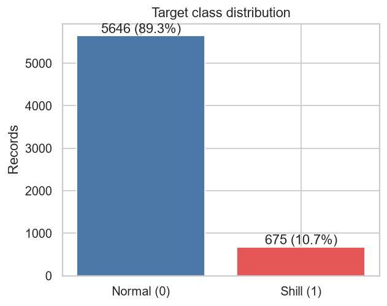
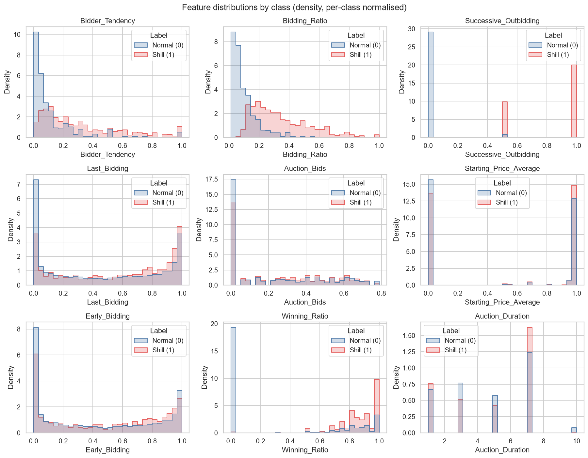
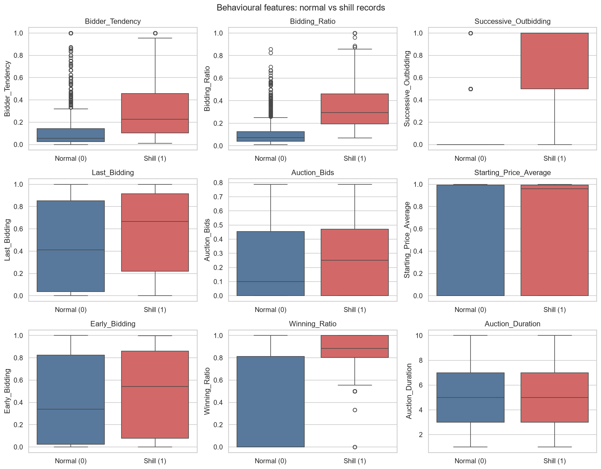
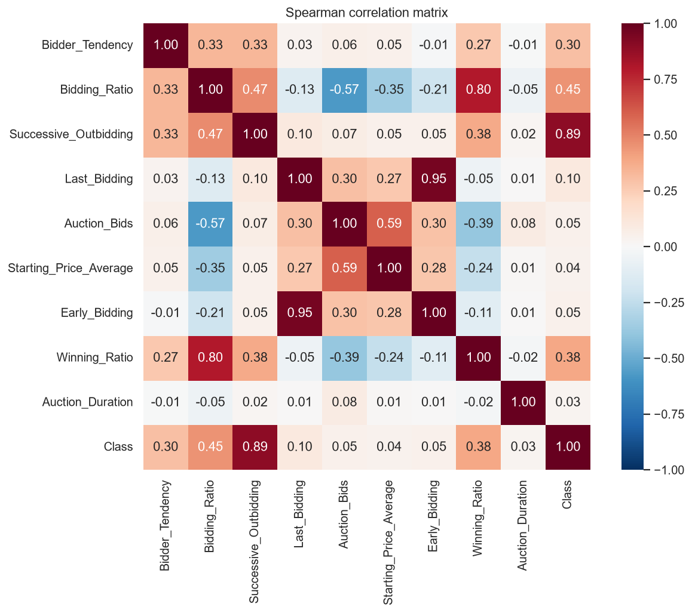
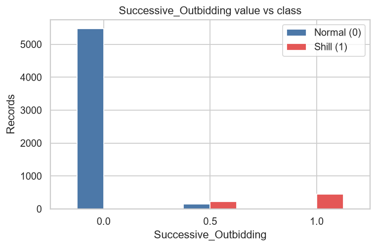
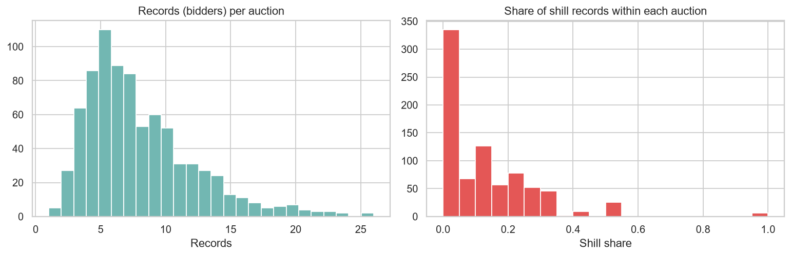
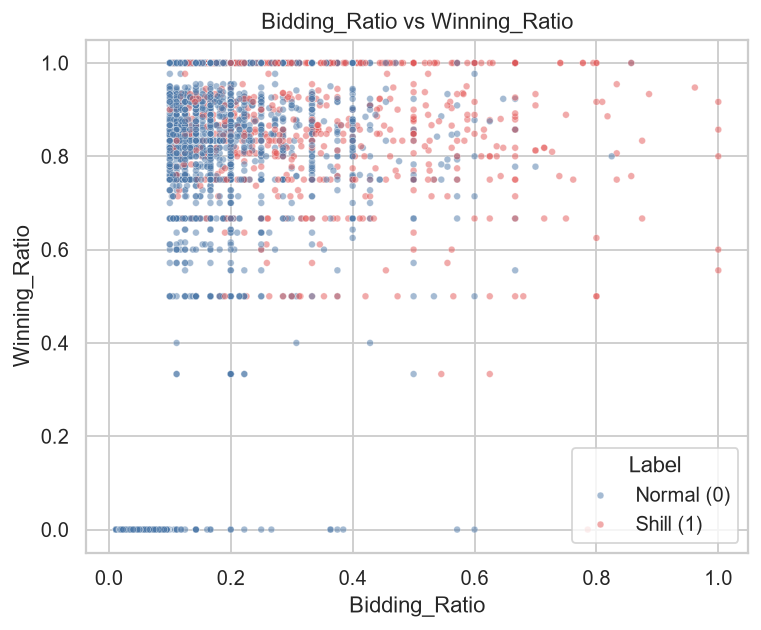

# Dataset Analysis Report - UCI Shill Bidding Dataset (ID 562)

*Generated automatically by `src/analysis/eda.py` from the official UCI download.
All values below are computed from the data.*

Source: https://archive.ics.uci.edu/dataset/562/shill+bidding+dataset - DOI https://doi.org/10.24432/C5Z611 - licence CC BY 4.0.

## 1. Structure

* Shape: **6321 rows x 13 columns**
* Missing values: **0**
* Exact duplicate rows: **0** (excluding Record_ID: 0)
* Duplicate behavioural feature vectors: **3**, of which
  **0** distinct vectors carry conflicting labels.
* `Bidder_ID` is a masked string (e.g. `_***i`); all other columns are numeric.

| column | unique_values |
|---|---|
| Record_ID | 6321 |
| Auction_ID | 807 |
| Bidder_ID | 1054 |
| Bidder_Tendency | 489 |
| Bidding_Ratio | 400 |
| Successive_Outbidding | 3 |
| Last_Bidding | 5807 |
| Auction_Bids | 49 |
| Starting_Price_Average | 22 |
| Early_Bidding | 5690 |
| Winning_Ratio | 72 |
| Auction_Duration | 5 |
| Class | 2 |

## 2. Target distribution and imbalance

| Class | Records | Share |
|---|---|---|
| 0 - Normal | 5646 | 89.32% |
| 1 - Shill | 675 | 10.68% |

Imbalance ratio (majority : minority) = **8.36 : 1**. The dataset is
moderately imbalanced, so accuracy is not an adequate metric (always predicting
"normal" already yields 89.3% accuracy). Precision, recall, F1 and
PR-AUC for the shill class are used instead, and class weighting is evaluated.

## 3. Descriptive statistics

| feature | mean | std | min | 50% | max |
|---|---|---|---|---|---|
| Bidder_Tendency | 0.1425 | 0.1971 | 0.0000 | 0.0625 | 1.0000 |
| Bidding_Ratio | 0.1277 | 0.1315 | 0.0118 | 0.0833 | 1.0000 |
| Successive_Outbidding | 0.1038 | 0.2797 | 0.0000 | 0.0000 | 1.0000 |
| Last_Bidding | 0.4631 | 0.3801 | 0.0000 | 0.4409 | 0.9999 |
| Auction_Bids | 0.2316 | 0.2553 | 0.0000 | 0.1429 | 0.7882 |
| Starting_Price_Average | 0.4728 | 0.4899 | 0.0000 | 0.0000 | 0.9999 |
| Early_Bidding | 0.4307 | 0.3808 | 0.0000 | 0.3601 | 0.9999 |
| Winning_Ratio | 0.3677 | 0.4366 | 0.0000 | 0.0000 | 1.0000 |
| Auction_Duration | 4.6151 | 2.4666 | 1.0000 | 5.0000 | 10.0000 |

Eight behavioural features are already normalised to [0, 1]; `Auction_Duration` is in days
with only 5 distinct values.

## 4. Behavioural differences between classes

Mann-Whitney U test (two-sided) and rank-biserial effect size (positive = higher in shill records):

| feature | mean_normal | mean_shill | median_normal | median_shill | mann_whitney_p | rank_biserial |
|---|---|---|---|---|---|---|
| Successive_Outbidding | 0.0166 | 0.8326 | 0.0000 | 1.0000 | < 1e-300 | 0.9839 |
| Bidding_Ratio | 0.1018 | 0.3443 | 0.0714 | 0.2941 | < 1e-300 | 0.8371 |
| Winning_Ratio | 0.3082 | 0.8653 | 0.0000 | 0.8846 | < 1e-300 | 0.6462 |
| Bidder_Tendency | 0.1224 | 0.3110 | 0.0556 | 0.2258 | < 1e-300 | 0.5665 |
| Last_Bidding | 0.4503 | 0.5705 | 0.4102 | 0.6648 | < 1e-300 | 0.1891 |
| Early_Bidding | 0.4236 | 0.4897 | 0.3397 | 0.5419 | 1.50e-05 | 0.1019 |
| Auction_Bids | 0.2276 | 0.2648 | 0.1000 | 0.2500 | 4.30e-05 | 0.0918 |
| Starting_Price_Average | 0.4656 | 0.5332 | 0.0000 | 0.9612 | 1.11e-03 | 0.0701 |
| Auction_Duration | 4.5971 | 4.7659 | 5.0000 | 5.0000 | 2.36e-02 | 0.0510 |

**Encoding direction.** Shill records have *higher* values of `Winning_Ratio`, `Last_Bidding` and
`Starting_Price_Average`, although the UCI descriptions say shill bidders rarely win, become inactive
near the end and that their sellers use *low* starting prices. This suggests every behavioural
feature is encoded as a suspicion score (higher = more shill-like) rather than as the raw quantity.
The UCI page does not publish the formulas, so this is an observation from the data, not a
documented fact; features should be interpreted as "suspicion indicators" rather than raw ratios.

### Successive_Outbidding is close to a deterministic indicator

| Successive_Outbidding | normal | shill |
|---|---|---|
| 0.0 | 5476 | 2 |
| 0.5 | 152 | 222 |
| 1.0 | 18 | 451 |

Only 2 shill records have
`Successive_Outbidding = 0`. A single-rule baseline ("flag if Successive_Outbidding > 0") is
therefore evaluated alongside the ML models to measure what the models add.

## 5. Correlation and redundancy

Spearman correlation with the target:

| feature | spearman_rho |
|---|---|
| Bidder_Tendency | 0.3031 |
| Bidding_Ratio | 0.4478 |
| Successive_Outbidding | 0.8915 |
| Last_Bidding | 0.1011 |
| Auction_Bids | 0.0515 |
| Starting_Price_Average | 0.0410 |
| Early_Bidding | 0.0545 |
| Winning_Ratio | 0.3849 |
| Auction_Duration | 0.0285 |

Feature pairs with |Spearman| >= 0.8:

| feature_a | feature_b | abs_spearman |
|---|---|---|
| Bidding_Ratio | Winning_Ratio | 0.8030 |
| Last_Bidding | Early_Bidding | 0.9532 |

`Last_Bidding` equals `Early_Bidding` exactly in **61.4%** of records
(bidders who placed a single bid have identical first and last bid times).

Mutual information with the target (full data, descriptive only):

| feature | mutual_information |
|---|---|
| Successive_Outbidding | 0.2849 |
| Bidding_Ratio | 0.1800 |
| Bidder_Tendency | 0.1280 |
| Winning_Ratio | 0.0991 |
| Last_Bidding | 0.0125 |
| Auction_Duration | 0.0052 |
| Early_Bidding | 0.0036 |
| Auction_Bids | 0.0009 |
| Starting_Price_Average | 0.0000 |

## 6. Group structure and implications for evaluation

* 807 auctions and 1054 distinct (masked) bidder IDs.
* Records per auction: median 7.0, max 26.0.
* 478 auctions contain at least one shill record; 472 of them also
  contain normal records.
* Auction-level features are constant within an auction (share of auctions with a single value):
  Auction_Bids: 100%, Starting_Price_Average: 100%, Auction_Duration: 100%.
  A row-level split therefore places records of the same auction in train and test.
* Bidder-level features are expected to be constant per bidder, but among masked bidder IDs with
  more than one record they are constant in only
  Bidder_Tendency: 13%, Winning_Ratio: 19% of cases.
  Either the masking (only the first and last characters are kept) merges different real bidders
  under one ID, or these features are computed per auction; in both cases a masked ID cannot be
  trusted as a unique bidder key, so **Bidder_ID-grouped validation is only approximate**.
  Auction_ID is the reliable grouping key.

## 7. Temporal availability / leakage assessment

| feature | measured_at | available_at | comment |
|---|---|---|---|
| Bidder_Tendency | bidder (across auctions) | history of the bidder across sellers | Available from bidder history; aggregated over the bidder's auctions. |
| Bidding_Ratio | bidder within auction | auction in progress / ended | Ratio of the bidder's bids to all bids in the auction; final value only known when the auction ends. |
| Successive_Outbidding | bidder within auction | auction in progress | Observable as bids arrive; final value known only at the end. |
| Last_Bidding | bidder within auction | auction ended | Time of the bidder's last bid relative to auction end - requires the auction to be finished. |
| Auction_Bids | auction | auction ended | Total bids in the auction relative to concurrent auctions - requires the auction to be finished. |
| Starting_Price_Average | auction | auction start | Known when the auction is listed. |
| Early_Bidding | bidder within auction | early in auction | Time of the bidder's first bid; available once the bidder has bid. |
| Winning_Ratio | bidder (across auctions) | auction outcomes | Proportion of the bidder's auctions won - depends on auction outcomes, i.e. post-auction information. |
| Auction_Duration | auction | auction start | Duration set by the seller at listing time. |

Several features (`Last_Bidding`, `Auction_Bids`, `Winning_Ratio`, final `Bidding_Ratio`) are only
known after an auction has ended. The model is therefore a **retrospective** detector suitable for
post-auction investigation, not real-time prevention.

## 8. Figures

