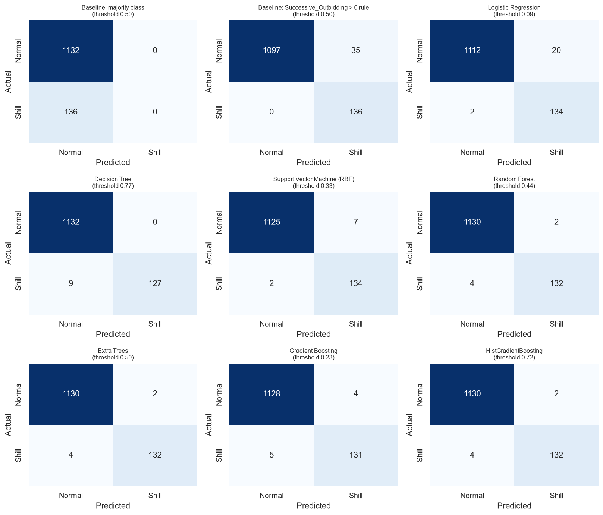
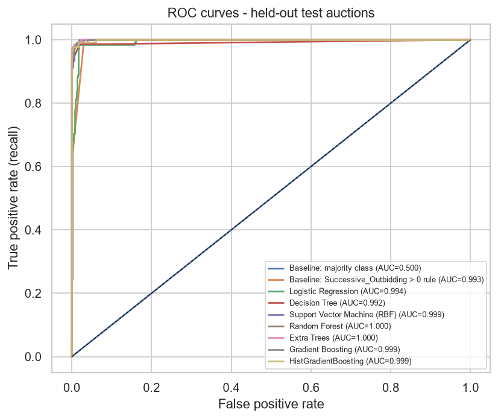
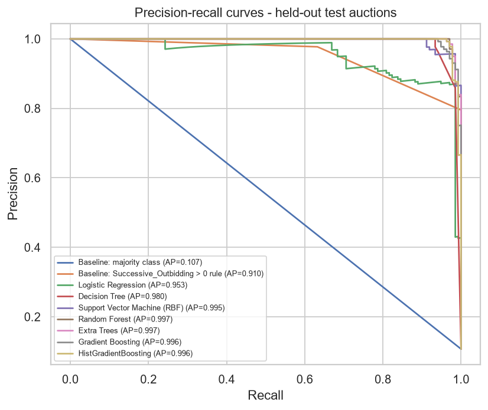
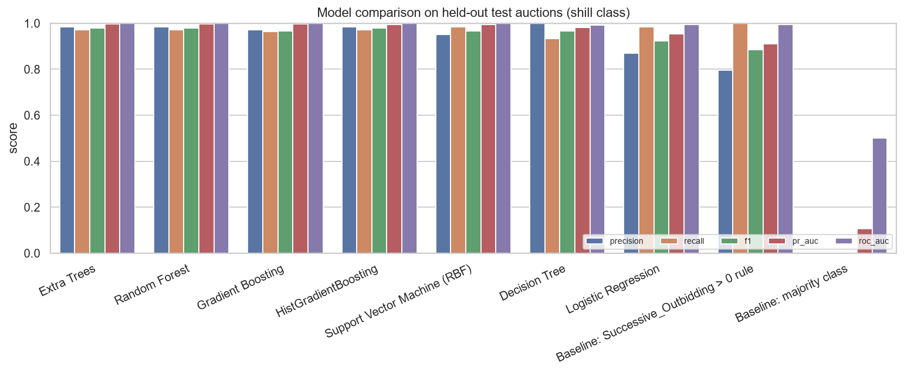
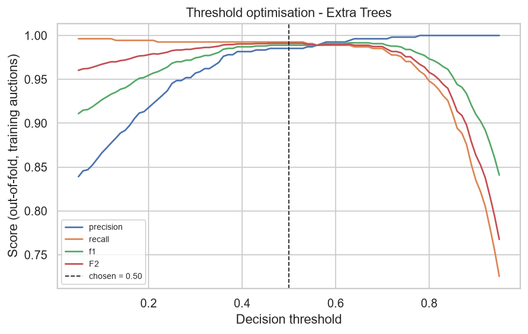
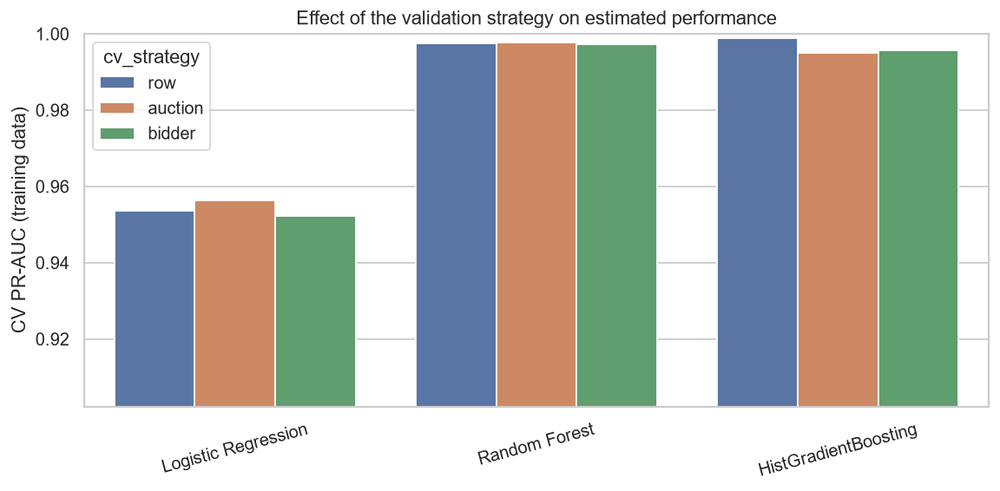
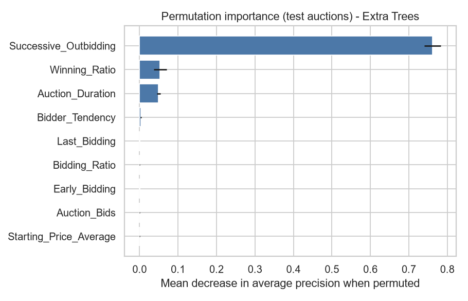
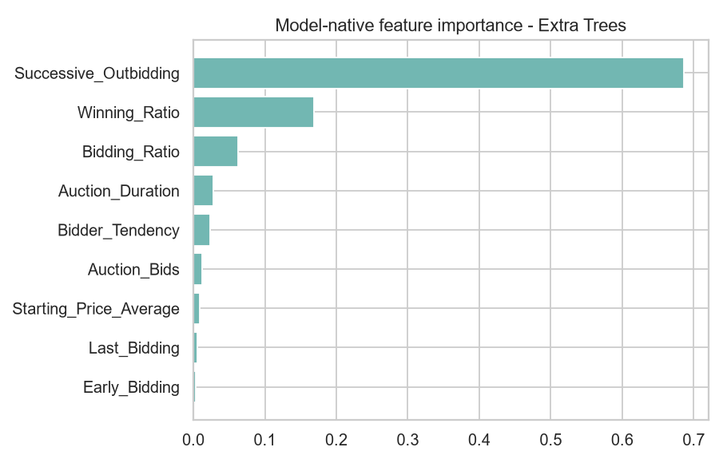
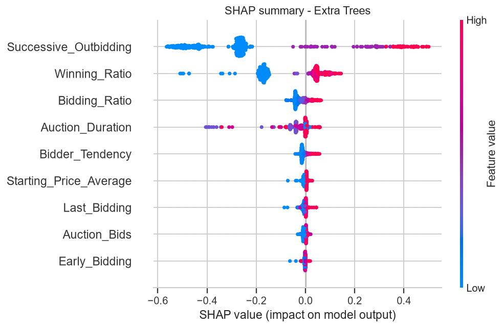

# Model Comparison Report

*Generated automatically by `src/training/train.py` on 2026-11-16T19:39:02. All values are
measured; nothing is hand-edited.* Model version: `extra_trees-20261116-193902`.

## 1. Experimental design

* **Hold-out split:** one fold of a shuffled `StratifiedGroupKFold` grouped by **Auction_ID**
  (seed 42). Train: 5053 records / 646 auctions
  (shill share 10.67%); test: 1268 records / 161
  auctions (shill share 10.73%).
* **Identifier overlap train/test:** Record_ID 0, Auction_ID
  0, masked Bidder_ID 511 shared IDs
  (1187 of 1268 test rows carry a masked bidder ID
  also present in training - see section 6).
* **Model selection / tuning:** 5-fold `StratifiedGroupKFold` by Auction_ID on the training split only,
  optimising average precision (PR-AUC).
* **Threshold:** Maximise F2 on out-of-fold training predictions subject to precision >= 0.8.
* **Selection rule:** Highest mean auction-grouped CV PR-AUC; models within 0.005 of the best are treated as tied and the simplest tied model is chosen.
* The test set was used only after the model had been selected.

## 2. Feature set

Features used (9): `Bidder_Tendency, Bidding_Ratio, Successive_Outbidding, Last_Bidding, Auction_Bids, Starting_Price_Average, Early_Bidding, Winning_Ratio, Auction_Duration`.

All features kept: removing correlated features lowered mean CV PR-AUC by 0.0080 (> tolerance 0.005).

| feature_set | n_features | model | pr_auc_mean | pr_auc_std | f1@0.5 |
|---|---|---|---|---|---|
| all_features | 9 | Logistic Regression | 0.9562 | 0.0131 | 0.8901 |
| all_features | 9 | Random Forest | 0.9976 | 0.0019 | 0.9761 |
| all_features | 9 | HistGradientBoosting | 0.9949 | 0.0060 | 0.9870 |
| reduced | 7 | Logistic Regression | 0.9371 | 0.0165 | 0.8593 |
| reduced | 7 | Random Forest | 0.9951 | 0.0024 | 0.9744 |
| reduced | 7 | HistGradientBoosting | 0.9925 | 0.0072 | 0.9852 |
| ablation_without_successive_outbidding | 8 | Logistic Regression | 0.7477 | 0.0526 | 0.6458 |
| ablation_without_successive_outbidding | 8 | Random Forest | 0.7606 | 0.0498 | 0.6768 |
| ablation_without_successive_outbidding | 8 | HistGradientBoosting | 0.7643 | 0.0414 | 0.6919 |

The ablation without `Successive_Outbidding` shows how much the models rely on this single indicator.

## 3. Validation strategy study (training data, untuned models)

CV PR-AUC by splitting strategy:

| model | auction | bidder | row |
|---|---|---|---|
| HistGradientBoosting | 0.9949 | 0.9957 | 0.9988 |
| Logistic Regression | 0.9562 | 0.9523 | 0.9537 |
| Random Forest | 0.9976 | 0.9973 | 0.9975 |

F1 at threshold 0.5:

| model | auction | bidder | row |
|---|---|---|---|
| HistGradientBoosting | 0.9870 | 0.9907 | 0.9870 |
| Logistic Regression | 0.8901 | 0.8946 | 0.8942 |
| Random Forest | 0.9761 | 0.9771 | 0.9717 |

Row-based CV mixes records of the same auction across folds; auction-grouped CV measures
performance on unseen auctions, which is the intended use case (scoring new, completed
auctions). Bidder-grouped CV relies on masked bidder IDs that are not unique keys, so it is
reported for completeness only.

## 4. Cross-validation results (training split, tuned)

| model | cv_pr_auc_mean | cv_pr_auc_std | oof_recall | oof_precision | best_params |
|---|---|---|---|---|---|
| Extra Trees | 0.9985 | 0.0020 | 0.9926 | 0.9853 | {"class_weight": "balanced_subsample", "max_depth": null, "max_features": 0.5, "min_samples_leaf": 1} |
| Random Forest | 0.9977 | 0.0022 | 0.9944 | 0.9589 | {"class_weight": null, "max_depth": 8, "max_features": 0.5, "min_samples_leaf": 1} |
| Gradient Boosting | 0.9975 | 0.0038 | 0.9944 | 0.9853 | {"learning_rate": 0.1, "max_depth": 3, "n_estimators": 300, "subsample": 0.8} |
| HistGradientBoosting | 0.9953 | 0.0060 | 0.9907 | 0.9834 | {"class_weight": "balanced", "l2_regularization": 0.0, "learning_rate": 0.1, "max_leaf_nodes": 15} |
| Support Vector Machine (RBF) | 0.9890 | 0.0025 | 0.9889 | 0.9096 | {"C": 10, "class_weight": null, "gamma": 1.0} |
| Decision Tree | 0.9870 | 0.0047 | 0.9629 | 0.9981 | {"class_weight": "balanced", "max_depth": 6, "min_samples_leaf": 5} |
| Logistic Regression | 0.9583 | 0.0124 | 0.9944 | 0.8428 | {"C": 100, "class_weight": null} |
| Baseline: Successive_Outbidding > 0 rule | 0.9033 | 0.0247 | 0.9963 | 0.7991 | {} |
| Baseline: majority class | 0.1067 | 0.0005 | 0.0000 | 0.0000 | {} |

## 5. Held-out test results (unseen auctions)

At each model's optimised threshold:

| model | threshold | accuracy | precision | recall | f1 | roc_auc | pr_auc | brier | tp | fp | fn | tn |
|---|---|---|---|---|---|---|---|---|---|---|---|---|
| Extra Trees | 0.5000 | 0.9953 | 0.9851 | 0.9706 | 0.9778 | 0.9996 | 0.9973 | 0.0041 | 132 | 2 | 4 | 1130 |
| Random Forest | 0.4400 | 0.9953 | 0.9851 | 0.9706 | 0.9778 | 0.9996 | 0.9973 | 0.0052 | 132 | 2 | 4 | 1130 |
| Gradient Boosting | 0.2300 | 0.9929 | 0.9704 | 0.9632 | 0.9668 | 0.9994 | 0.9959 | 0.0058 | 131 | 4 | 5 | 1128 |
| HistGradientBoosting | 0.7200 | 0.9953 | 0.9851 | 0.9706 | 0.9778 | 0.9993 | 0.9956 | 0.0043 | 132 | 2 | 4 | 1130 |
| Support Vector Machine (RBF) | 0.3300 | 0.9929 | 0.9504 | 0.9853 | 0.9675 | 0.9994 | 0.9951 | 0.0063 | 134 | 7 | 2 | 1125 |
| Decision Tree | 0.7700 | 0.9929 | 1.0000 | 0.9338 | 0.9658 | 0.9920 | 0.9804 | 0.0095 | 127 | 0 | 9 | 1132 |
| Logistic Regression | 0.0900 | 0.9826 | 0.8701 | 0.9853 | 0.9241 | 0.9936 | 0.9528 | 0.0174 | 134 | 20 | 2 | 1112 |
| Baseline: Successive_Outbidding > 0 rule | 0.5000 | 0.9724 | 0.7953 | 1.0000 | 0.8860 | 0.9934 | 0.9104 | 0.0179 | 136 | 35 | 0 | 1097 |
| Baseline: majority class | 0.5000 | 0.8927 | 0.0000 | 0.0000 | 0.0000 | 0.5000 | 0.1073 | 0.0958 | 0 | 0 | 136 | 1132 |

At the default threshold 0.5:

| model | precision@0.5 | recall@0.5 | f1@0.5 |
|---|---|---|---|
| Extra Trees | 0.9851 | 0.9706 | 0.9778 |
| Random Forest | 1.0000 | 0.9706 | 0.9851 |
| Gradient Boosting | 0.9774 | 0.9559 | 0.9665 |
| HistGradientBoosting | 0.9708 | 0.9779 | 0.9744 |
| Support Vector Machine (RBF) | 0.9549 | 0.9338 | 0.9442 |
| Decision Tree | 0.8590 | 0.9853 | 0.9178 |
| Logistic Regression | 0.8889 | 0.8235 | 0.8550 |
| Baseline: Successive_Outbidding > 0 rule | 0.7953 | 1.0000 | 0.8860 |
| Baseline: majority class | 0.0000 | 0.0000 | 0.0000 |

### Selected model: **Extra Trees**

* Test PR-AUC 0.9973, ROC-AUC 0.9996, precision 0.9851,
  recall 0.9706, F1 0.9778 at threshold 0.50.
* Confusion matrix: TP 132, FP 2, FN 4, TN 1130.
* For comparison, the one-feature rule `Successive_Outbidding > 0` reaches precision
  0.7953 / recall 1.0000 / F1 0.8860 on the same test set.

Classification report (selected model, test set):

```
              precision    recall  f1-score   support

      Normal     0.9965    0.9982    0.9974      1132
       Shill     0.9851    0.9706    0.9778       136

    accuracy                         0.9953      1268
   macro avg     0.9908    0.9844    0.9876      1268
weighted avg     0.9953    0.9953    0.9953      1268

```

## 6. Generalisation to unseen bidder IDs (selected model, test set)

| subset | rows | shill | precision | recall | f1 |
|---|---|---|---|---|---|
| bidder_id_seen_in_training | 1187 | 125 | 0.9843 | 1.0000 | 0.9921 |
| bidder_id_unseen | 81 | 11 | 1.0000 | 0.6364 | 0.7778 |

## 7. Global feature importance (selected model)

Permutation importance on the test set (decrease in average precision):

| feature | importance_mean | importance_std |
|---|---|---|
| Successive_Outbidding | 0.7614 | 0.0219 |
| Winning_Ratio | 0.0536 | 0.0168 |
| Auction_Duration | 0.0493 | 0.0047 |
| Bidder_Tendency | 0.0035 | 0.0011 |
| Last_Bidding | 0.0009 | 0.0004 |
| Bidding_Ratio | 0.0006 | 0.0007 |
| Early_Bidding | 0.0006 | 0.0002 |
| Auction_Bids | 0.0002 | 0.0003 |
| Starting_Price_Average | 0.0001 | 0.0001 |

Explanation method for individual predictions: **SHAP**.

## 8. Decision-tree rules (tuned Decision Tree, first levels)

```
|--- Successive_Outbidding <= 0.25
|   |--- Bidder_Tendency <= 0.94
|   |   |--- class: 0
|   |--- Bidder_Tendency >  0.94
|   |   |--- Early_Bidding <= 0.47
|   |   |   |--- Auction_Bids <= 0.07
|   |   |   |   |--- class: 0
|   |   |   |--- Auction_Bids >  0.07
|   |   |   |   |--- class: 0
|   |   |--- Early_Bidding >  0.47
|   |   |   |--- Bidding_Ratio <= 0.13
|   |   |   |   |--- Last_Bidding <= 0.76
|   |   |   |   |   |--- class: 0
|   |   |   |   |--- Last_Bidding >  0.76
|   |   |   |   |   |--- class: 0
|   |   |   |--- Bidding_Ratio >  0.13
|   |   |   |   |--- class: 1
|--- Successive_Outbidding >  0.25
|   |--- Winning_Ratio <= 0.17
|   |   |--- Bidder_Tendency <= 0.88
|   |   |   |--- class: 0
|   |   |--- Bidder_Tendency >  0.88
|   |   |   |--- class: 1
|   |--- Winning_Ratio >  0.17
|   |   |--- Auction_Duration <= 8.50
|   |   |   |--- Successive_Outbidding <= 0.75
|   |   |   |   |--- Auction_Duration <= 6.00
|   |   |   |   |   |--- truncated branch of depth 2
|   |   |   |   |--- Auction_Duration >  6.00
|   |   |   |   |   |--- truncated branch of depth 2
|   |   |   |--- Successive_Outbidding >  0.75
|   |   |   |   |--- class: 1
|   |   |--- Auction_Duration >  8.50
|   |   |   |--- class: 0

```

## 9. Figures










